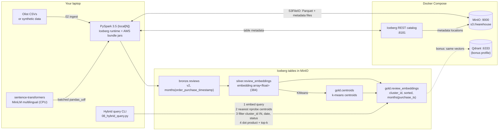

# Architecture

## Layers

| Layer | Table | Content |
|---|---|---|
| Bronze | `lake.bronze.reviews` | orders ⨝ reviews, review text cleaned, `has_review_text` flag, partitioned by month |
| Silver | `lake.silver.review_embeddings` | one 384-d L2-normalised `array<float>` per review that has text |
| Gold | `lake.gold.centroids` | the IVF "coarse quantizer": k unit-norm centroids |
| Gold | `lake.gold.review_embeddings` | silver + `cluster_id`, partitioned by month, **sorted by `cluster_id`** |

## How a hybrid IVF query works

1. Embed the query text locally (same model, same normalisation as the data).
2. Dot the query with the k centroids in Python; keep the `nprobe` best.
3. Run Spark SQL: `WHERE purchase_ts >= … AND order_status = … AND cluster_id IN (…)`.
   - month partition pruning removes whole date ranges,
   - the `cluster_id` min/max statistics in the manifests let Iceberg skip files of other clusters,
   - only the surviving rows are scored with `aggregate(zip_with(embedding, query, *), …)`.
4. `ORDER BY score DESC LIMIT k`.

## What is and isn't Iceberg

Iceberg stores the vectors as plain `array<float>` and gives us partition pruning plus per-file column statistics.
It has **no vector type and no ANN index**. The IVF technique (k-means, `cluster_id`, probing the nearest
clusters) is application-level code in this repo that happens to exploit Iceberg's file statistics.
